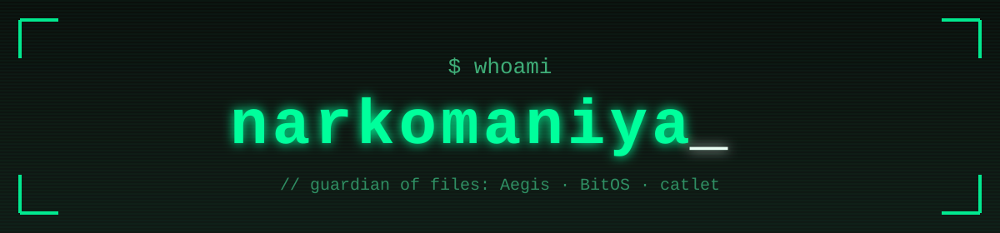
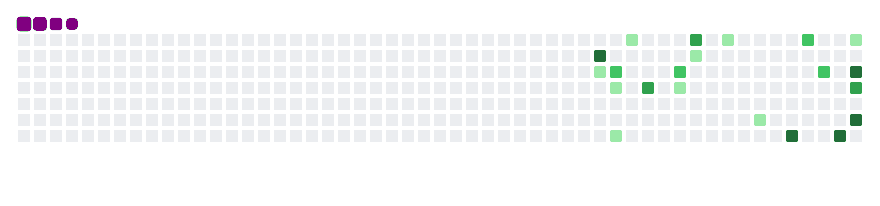

  

  

  

    
    
  

---

<picture>
  <source media="(prefers-color-scheme: light)" srcset="https://raw.githubusercontent.com/narkomaniya/narkomaniya/output/github-contribution-grid-snake.svg" />
  
</picture>

---
